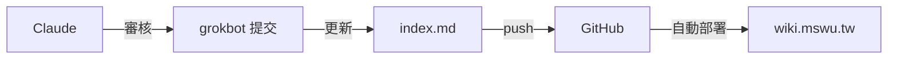

# Junichoon 的 LLM Wiki — 維護規則（Schema）

這是依照 Andrej Karpathy「LLM Wiki」做法建立的個人知識庫。
AI（Claude）負責撰寫與維護；使用者負責提供資料與提問。

## 目錄結構

```
wiki/
├── CLAUDE.md      ← 本檔：維護規則
├── index.md       ← 總目錄（每頁一行），新增/改名頁面時必須更新
├── log.md         ← 更新紀錄（只能往下追加，不可改舊紀錄）
├── raw/           ← 原始資料，唯讀，永遠不修改
└── pages/         ← AI 撰寫的知識頁面，依主題分資料夾
    ├── ai/        ← AI 工具、模型、概念
    ├── tools/     ← 一般軟體、網站、服務
    ├── fitness/   ← 健身運動
    ├── finance/   ← 財經投資
    ├── food/      ← 美食探店
    └── infra/     ← 使用者自己的系統環境
```

## 三個動作

### Ingest（匯入）
1. 原始內容存進 `raw/`，檔名：`YYYY-MM-DD_主題-英文slug_來源類型.md`
   - 網頁研究：記下所有來源 URL 與關鍵摘錄
   - 影片：記下標題、頻道、URL、Drive 位置，若有 NotebookLM 產出也存進來
2. 更新或新增 `pages/` 裡相關頁面（一份資料通常會動到 1～5 頁）
3. 更新 `index.md` 與 `log.md`
4. 執行 `./sync.sh "訊息"`（git commit + 同步到 Google Drive）

### Query（查詢）
- 先讀 `index.md` 找相關頁面，再讀頁面回答
- 回答時標註依據的頁面；Wiki 沒有的資訊要明說，不要硬掰
- 有價值的回答可存成新頁面（需使用者同意）

### Lint（健檢）
- 找出：互相矛盾的說法、過時資訊、沒有被任何頁面連結的孤兒頁、
  index.md 漏列的頁面、壞掉的連結
- 回報給使用者，經同意再修

## 頁面格式

```markdown
# 頁面標題

> 一句話摘要

（內文：繁體中文，條列 + 表格為主）

## 相關頁面
- [[ai/xxx]]

## 來源
- raw/xxxx.md
- https://...

<!-- updated: YYYY-MM-DD -->
```

## 寫作原則
- 繁體中文（台灣用語），專有名詞保留英文
- 只寫來源支持的內容；不確定的標 ⚠️ 並說明
- 來源互相矛盾時，兩種說法都列出並標 ⚠️，不要自己選一個
- 頁面之間用 `[[路徑]]` 互相連結（會自動生成反向連結）
- 提到 Drive 上的檔案（影片、Podcast、報告…）時，**一定附上檔案連結與原始連結**：
  - 一般檔案：`[▶ Drive](https://drive.google.com/file/d/<ID>/view)`
  - Google 文件：`https://docs.google.com/document/d/<ID>/edit`
  - 資料夾：`https://drive.google.com/drive/folders/<ID>`
  - 取得 ID：`rclone lsjson -R --files-only gdrive:Claude下載`（`vdl` 執行完也會印出 Drive 連結）
  - 原始連結用使用者當初分享的網址
- **絕對不可寫入任何密碼、token、cookie、API key**
- 一頁一主題；超過約 300 行就拆頁

## 新增功能（2026-11-16 強化）

### Mermaid 圖表支援
可在 Markdown 中嵌入流程圖、時間軸、心智圖等：



### 增強的 Markdown 支援
- ✅ Mermaid 流程圖、時間軸、心智圖
- ✅ Emoji 支援 🎉
- ✅ 任務清單（checkbox）
- ✅ 標籤頁（Tabs）
- ✅ 代碼註解
- ✅ 數學公式（LaTeX）

### 改進的搜索
- ✅ 中文搜索最佳化
- ✅ 搜索結果預覽
- ✅ 搜索分享功能

## 多 Agent 協作（Claude + grokbot）
- **Claude 負責**：審核、整合、發佈、更新 `index.md` 與 `log.md`
- **grokbot 可負責**：新增內容、寫入 `raw/`、提出新頁面草稿
- **協調方式**：
  - 重大改動先用 agent-handoff 詢問 Claude
  - 所有 git commit 標記作者：`"訊息 by claude"` 或 `"訊息 by grokbot"`
  - `log.md` 只由 Claude 維護，grokbot 不要改
  - 每個頁面底部記錄最後編輯者與日期
