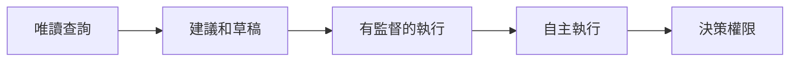
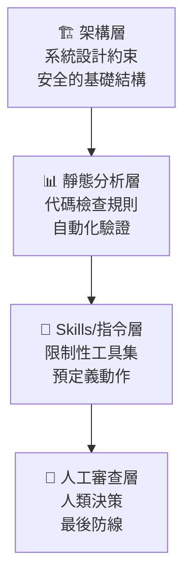

# AI 同事（Grok Bot）設計原則

> Lauren Tan 與 Roman Ugarte 在 YC Lightcone 談論如何讓 AI 成為真正的協作同事。

## 核心概念

### 三項設計原則

1. **持續角色，而非一次性對話**
   - Bot 是團隊的常駐成員，不是臨時助手
   - 擁有身分、記憶、責任歸屬
   - 可在工作場域主動推進任務

2. **真實工具與帳號存取**
   - 授予與人類同事相同的系統權限
   - 能直接操作實際工作工具（代碼倉庫、部署系統等）
   - 與人類共享責任和結果

3. **主動運行，不被動回應**
   - 持續監控任務狀態
   - 主動推進工作進度
   - 在必要時尋求人類審查或決策

## 權限與信任架構

### 漸進式權限擴展

> 「就像培養新員工一樣」— Lauren Tan



### 三個信任階段（Roman Ugarte）

| 階段 | 特徵 | 權限範圍 |
|---|---|---|
| **1. 探索階段** | 只讀查詢，學習系統 | 檢視、提問、分析 |
| **2. 貢獻階段** | 有審查的執行 | 提交 PR、建議、草稿 |
| **3. 擁有者階段** | 自主職責管理 | 獨立決策、直接部署 |

### 問責制原則

- 每個 Bot 需要明確的**人類所有者**
- 所有者對 Bot 的行動負責
- 權限與責任必須對稱
- 定期審查和調整權限

## 工作流重構

### Slack 串工作流示例

Lauren Tan 展示的實際案例：

```
想法 (Slack)
  ↓
grokbot: 分析需求
  ↓
grokbot: 編寫代碼
  ↓
人類: 審查和測試
  ↓
grokbot: 修改反饋
  ↓
人類: 核准
  ↓
grokbot: 自動部署
  ↓
✅ 上線（約 200 則訊息）
```

**關鍵特點：**
- 同一對話線內完成整個流程
- 團隊審查的是**產出物**，而非代碼差異
- 人類保持決策權
- Bot 負責執行和迭代

## 護欄經濟學四層

風險管理由低至高自動化：



**原則：** 越下層的約束越自動化，越上層越需要人類判斷。

## 瓶頸轉移

### 傳統工作流
```
約束：執行能力
  ↓
解決方案：自動化、工具、外包
```

### AI 同事時代
```
約束：「做什麼」的決策
  ↓
解決方案：更好的產品判斷力、戰略思考
  ↓
結果：執行不再稀缺，決策變成瓶頸
```

**人類的新角色：**
- 🎯 定義方向和優先級
- 🔍 審查和驗證結果
- 🧠 做出戰略決策
- 📈 優化工作流程

## 與你的 grokbot 專案的關聯

| Grok Bot 原則 | 你的 Wiki 實踐 |
|---|---|
| 持續角色 | grokbot 在 GitHub/Wiki 中常駐 |
| 真實權限 | grokbot 有 GitHub push 權限 |
| 主動運行 | grokbot 主動提交編輯 |
| 漸進信任 | Claude 審核 → grokbot 升級為自主發佈 |
| 問責制 | grokbot 標記所有 commit，Claude 審查 log |

## 設計建議（應用到 grokbot）

### 現在（第 1 層）
- ✅ grokbot 提出內容建議
- ✅ Claude 審查並決策
- ✅ GitHub push 權限受限

### 下一步（第 2 層）
- grokbot 自主編輯和提交
- Claude 事後審查 log.md
- 漸進擴展 grokbot 的決策權

### 長期（第 3 層）
- grokbot 自主管理某些主題頁面
- Claude 保留審查權但減少干預
- 專注在戰略和品質把關

## 相關主題

- [[ai/multi-agent-workflows]]
- [[ai/google-antigravity-swarm]]
- [[ai/mermaid-examples]] — 工作流圖表

## 來源

- 原文：[Lauren Tan AI Coworkers](https://notes.pahud.dev/lauren-tan-ai-coworkers/)
- 來源：Y Combinator Lightcone 播客
- 講者：Lauren Tan, Roman Ugarte（xAI）
- 主題：Grok Bot 設計原則與最佳實踐

<!-- updated: 2026-11-16 -->
