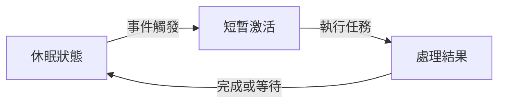
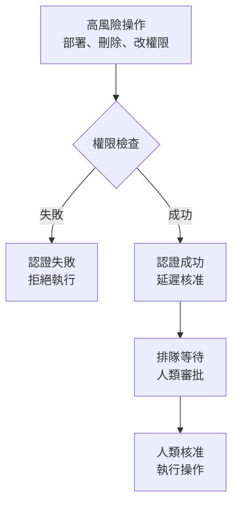
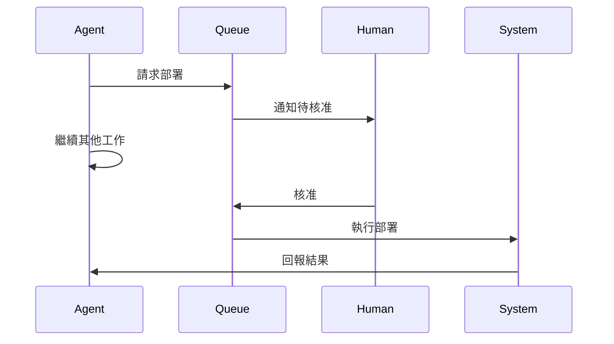

# Always-On Agents：持續運行 Agent 架構

> Anthropic 官方指南：如何構建真正的持續運行 Agent，而非虛假的 24/7 錯覺。

## 核心洞察

**Always-On 不是 24/7**

大多數持續運行 Agent 的真實運作方式：
- 95% 的時間：**休眠**（無成本）
- 5% 的時間：**被喚醒** 執行任務
- 完成任務後：**立即休眠**



## 五大基礎元件

### 1️⃣ 事件收件箱（Event Inbox）

**目的**：集中管理所有傳入事件，避免衝突

```
事件來源：
  ├─ 使用者訊息（Chat）
  ├─ Webhook（來自外部系統）
  ├─ 計時器（排程任務）
  └─ 其他 Agent（協作訊息）
         ↓
    事件收件箱
         ↓
  優先級排隊 → 順序處理
```

**關鍵優勢：**
- 防止同時觸發多個 run（避免衝突修改）
- 明確的優先級管理
- 重試機制（失敗事件可重新入隊）

### 2️⃣ 計時器（Timers）

**目的**：主動喚醒 Agent，而非被動等待

**兩種模式：**

| 類型 | 用途 | 範例 |
|---|---|---|
| **Follow-up** | 一次性後續任務 | 24 小時後查看進度、等待審批結果 |
| **Periodic** | 週期性任務 | 每日檢查郵件、每週報告、定期同步 |

**實現方式：**
```python
# Follow-up 範例
schedule_timer(
    agent_id="grokbot",
    trigger_time=now + timedelta(hours=24),
    message="Check status of pending PRs"
)

# Periodic 範例
schedule_timer(
    agent_id="grokbot",
    interval=timedelta(days=1),
    message="Daily Wiki sync check"
)
```

### 3️⃣ 記憶系統（Memory）

**目的**：外部持久化儲存，跨越 context 窗口和 session

**必須保存的資訊：**
- 📝 用戶指示（Instruction）
- 📋 筆記和進度（Notes）
- 🎯 目標狀態（Goal State）
- 🧠 團隊共享知識（Team Knowledge）

**不要保存在 Memory 中：**
- ❌ 外部系統已有的資料（查詢外部 API）
- ❌ 實時狀態（直接檢查當前狀態）
- ❌ 大型文件（用連結代替）

**實現範例：**
```
Agent Memory 結構：
├─ Instructions
│  ├─ Wiki 維護規則（CLAUDE.md）
│  └─ Grokbot 權限範圍
├─ Progress
│  ├─ 最後同步時間
│  └─ 進行中的任務
└─ Knowledge
   ├─ Wiki 結構
   └─ 團隊約定
```

### 4️⃣ 權限管理（Authorization）

**目的**：控制無人監督下的風險

**三層安全機制：**



**具體做法：**

1. **憑證隔離**
   - Agent 只持有必要的權限
   - 高風險操作需要特殊權限

2. **自動分類**
   - 低風險：自動執行（查詢、只讀）
   - 中風險：排隊待核准
   - 高風險：強制人類決策

3. **延遲工具呼叫**
   - 高風險操作進入「待核准隊列」
   - Agent 繼續其他工作
   - 人類核准後異步執行
   - 核准與執行並行進行

### 5️⃣ 輸出箱（Output Box）

**目的**：管理推送訊息的頻率和音量

**常見問題：**
- ❌ Agent 過度通知（洗版）
- ❌ 重複發送同樣訊息
- ❌ 訊息順序錯亂

**解決方案：**

| 策略 | 實現 |
|---|---|
| **批次處理** | 累積多個事件，定期推送摘要 |
| **去重複** | 相同訊息只發一次 |
| **優先級** | 重要訊息即時，常規消息批次 |
| **靜音期** | 避免同時發送太多訊息 |

**實現範例：**
```
Agent 操作 → 生成通知 → 輸出箱隊列 → 聚合/去重 → 推送給用戶
```

## 設計原則

### 1. 連續性依賴外部存儲

```
❌ 錯誤：
Agent Context Window
  └─ 只存最近 100K tokens
  └─ Session 結束 = 記憶消失

✅ 正確：
Agent + 外部記憶系統
  ├─ Agent: 當前對話
  └─ Database: 完整歷史 + 狀態
```

### 2. 高風險操作要延遲核准



### 3. 信任靠「適度沉默」

> 不是靠頻繁互動來建立信任，而是靠證明能在最少人類干預下達成目標。

- 🟢 **優秀 Agent**：執行任務，只在必要時報告
- 🔴 **差劣 Agent**：頻繁詢問，為小事驚擾人類

## 與你的 grokbot 項目的應用

### 現在的架構
```
用戶 → agent-handoff → grokbot
       （手動觸發）
```

### 未來的 Always-On 架構
```
事件來源：
  ├─ GitHub webhook（新 PR、新 commit）
  ├─ Timer（每日檢查、定期同步）
  └─ Handoff 訊息（緊急任務）
         ↓
    事件收件箱
         ↓
  grokbot 被喚醒
         ↓
  查詢記憶（Wiki 規則、進度）
         ↓
  執行任務（編輯、審查、同步）
         ↓
  高風險操作？
      ├─ 是 → 延遲核准隊列
      └─ 否 → 直接執行
         ↓
  推送輸出（摘要通知）
         ↓
  進入休眠
```

### 具體實現步驟

**第 1 階段（已完成）**
- ✅ grokbot 有 GitHub 權限
- ✅ grokbot 有記憶系統（GROKBOT_PROMPT.md）

**第 2 階段（可實現）**
- 🔄 添加 GitHub webhook 觸發
- 🔄 實現計時器（定期檢查）
- 🔄 完善權限檢查

**第 3 階段（進階）**
- 🔮 實現延遲核准隊列
- 🔮 優化輸出箱（聚合通知）
- 🔮 自動分類風險等級

## 相關主題

- [[ai/ai-coworkers-grok-bot]] — Grok Bot 設計原則
- [[ai/multi-agent-workflows]] — 多 Agent 開發流程
- [[ai/google-antigravity-swarm]] — Swarm 模式

## 來源

- 原文：[Building Always-On Agents](https://notes.pahud.dev/building-always-on-agents/)
- 基礎：Anthropic 官方架構指南
- 相關：AI 同事、持續運行系統設計

<!-- updated: 2026-11-16 -->
