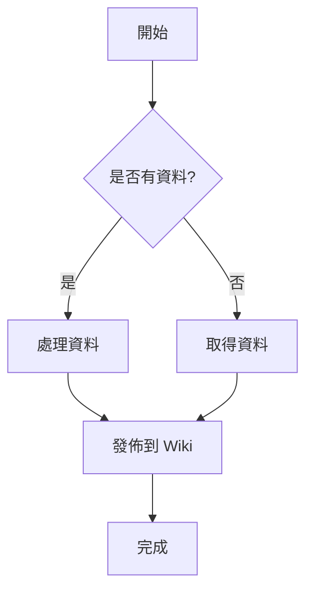
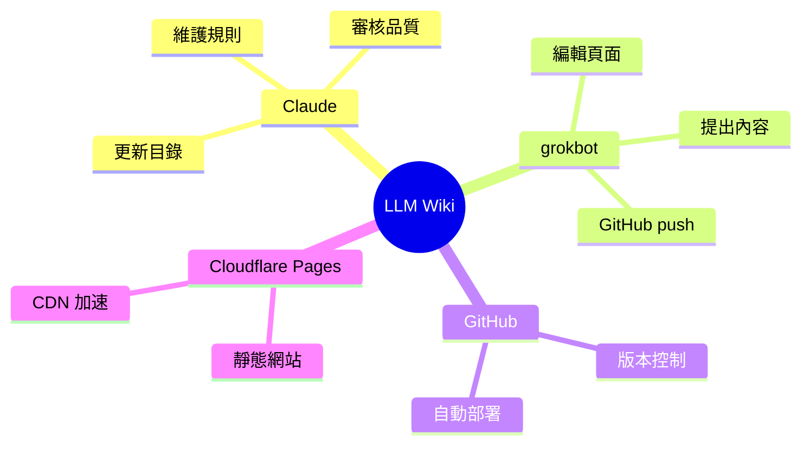
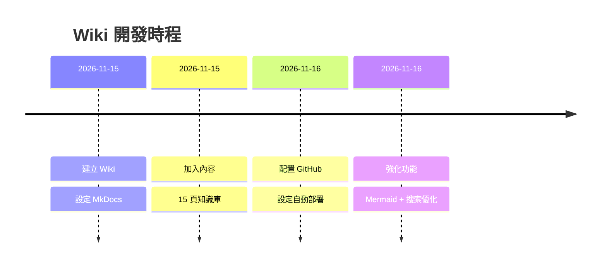
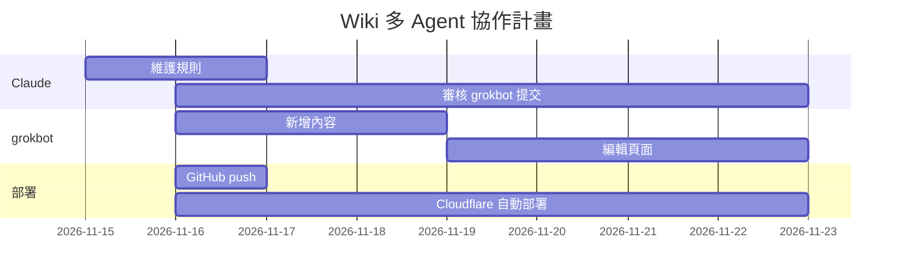
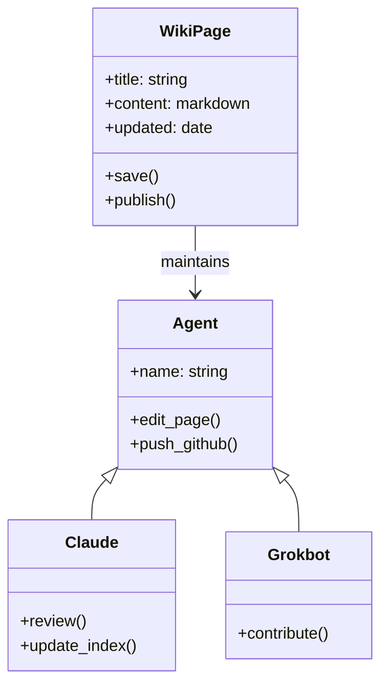
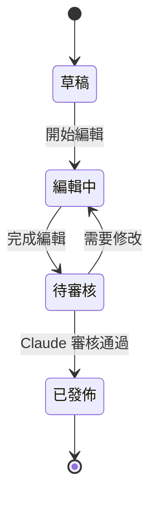
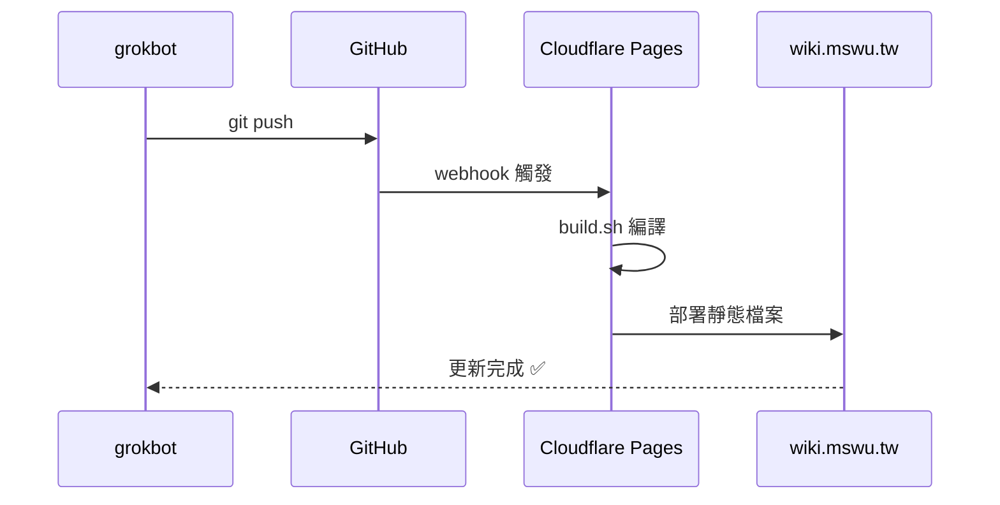

# Mermaid 圖表示例

> Wiki 現在支援 Mermaid 圖表！用來畫流程圖、心智圖、時間軸等。

## 流程圖（Flowchart）



## 心智圖（Mind Map）



## 時間軸（Timeline）



## 甘特圖（Gantt）



## 類別圖（Class Diagram）



## 狀態圖（State Diagram）



## 序列圖（Sequence Diagram）



---

## 怎麼使用

在你的 Wiki 頁面中，用三個反引號加 `mermaid`：

```
​```mermaid
graph LR
  A[Claude] --> B[grokbot]
  B --> C[Wiki]
​```
```

渲染結果就會出現上面的圖表！

---

## 相關主題

- [[ai/multi-agent-workflows]]
- [[ai/google-antigravity-swarm]]

## 來源

- Mermaid 官方：https://mermaid.js.org/
- MkDocs Material Mermaid 整合

<!-- updated: 2026-11-16 -->
